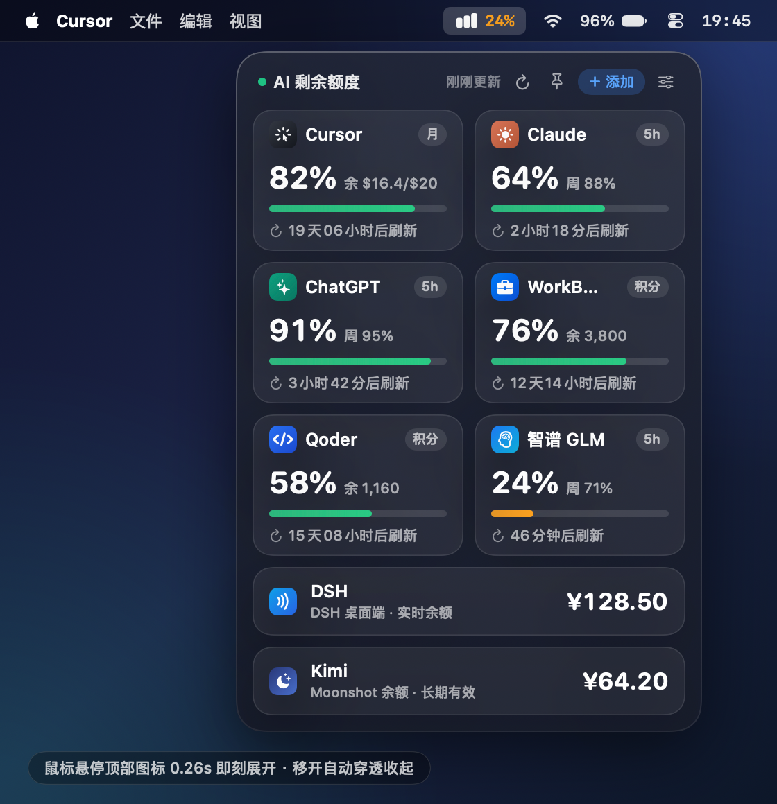
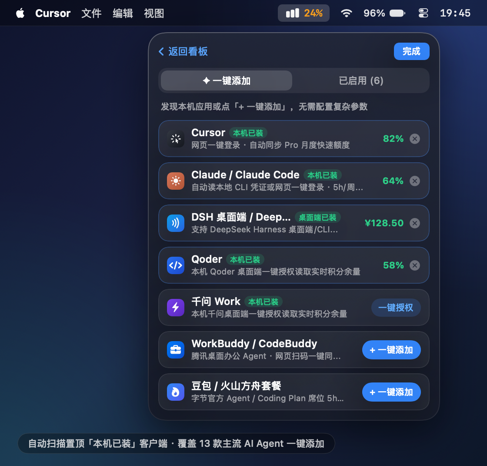
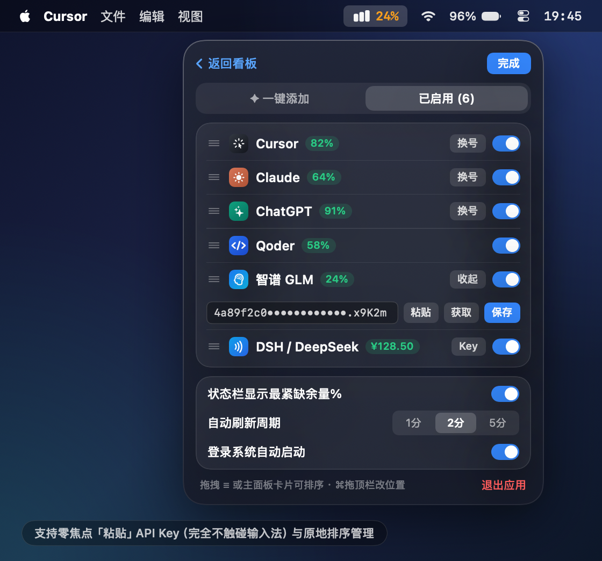
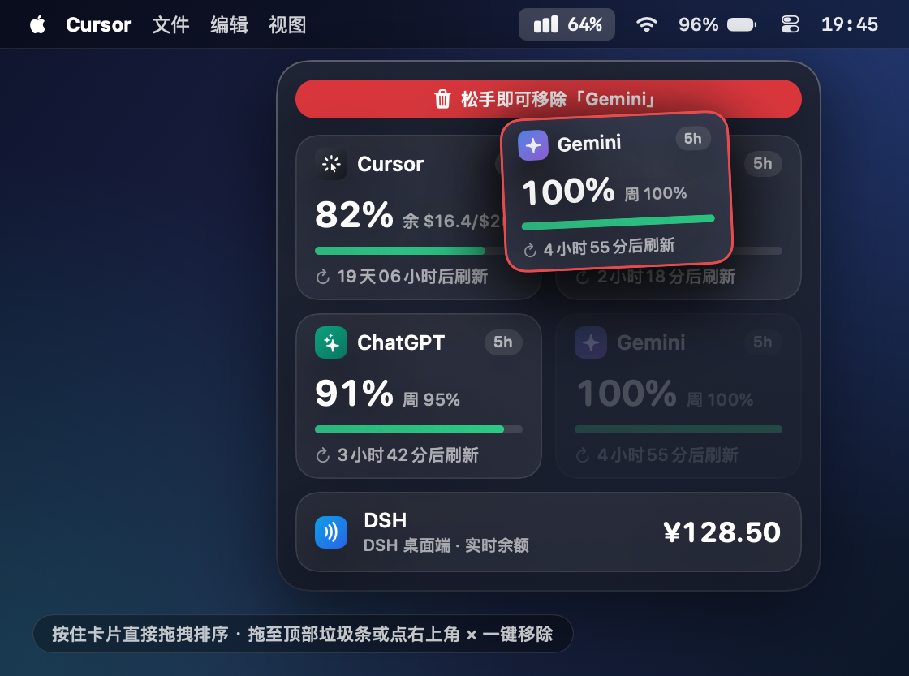

# AIQuotaHover — 纯原生单进程 macOS 悬停 AI 额度小组件栏

<p>
  
  
  
  
</p>

**AIQuotaHover** 是一款 **100% 零外部依赖、单二进制纯原生 Swift / SwiftUI** 构建的 macOS 状态栏工具。鼠标移到顶部菜单栏图标上**悬停（Hover）即刻展开毛玻璃 Bento 小组件面板**，移开自动穿透收起，无打扰实时查看各大主流 AI 编程工具与 Agent 的**「剩余额度」**与**「刷新倒计时」**。

---

## 界面完整截图

| 1. 悬停即显 · Bento 实时额度看板 | 2. `✦ 一键添加` · 自动识别本机已装客户端 |
| :---: | :---: |
|  |  |
| **3. `已启用` 服务管理 · 零焦点粘贴与偏好配置** | **4. 自由拖拽排序 · 拖至顶栏一键移除卡片** |
|  |  |

---

## 核心特性

- **单二进制纯原生运行**：无后台守护子进程、无本地监听端口、不常驻隐藏 WebView（`WKWebView` 登录用完即销毁，常驻 `0 MB` WebKit 内存，空闲 `0.0% CPU`），单 `.app` 拖入 `/Applications` 即开即用。
- **零点击悬停即显（Hover to Peek）**：鼠标停驻在状态栏图标 `260ms` 展开（防止划过菜单栏点击邻近图标时误弹），移出自动穿透收起；动态感知刘海屏/外接显示器菜单栏高度与右上角通知横幅（如钉钉消息横幅）自动让位；支持按住 `⌘ Command` 自由拖拽调整菜单栏位置。
- **全输入法零干扰守护（Generic IME Protection）**：
  - 自定义 `SilentHostingView` + `.nonactivatingPanel`，悬停、点击按钮与粘贴 API Key **永不抢占前台应用焦点、不注册多余 `NSTextInputContext`**；
  - 基于 macOS 官方 `Carbon.HIToolbox`（`kTISPropertyInputSourceType`）通用识别系统内**任意输入法**（苹果原生拼音/双拼/五笔、搜狗输入法、微信输入法、鼠须管 Rime、百度/讯飞、日韩注音等），彻底杜绝菜单栏弹窗把中文/多语种输入法误切回英文 `ABC` 的顽疾。
- **傻瓜式一键添加 + 自由拖拽排序/移除**：
  - 面板右上角点 **`+ 添加`**，内置主流 **13 款 AI 编程 / Agent 应用**声明式目录，自动扫描并置顶**「本机已装 / 桌面端已装」**应用；
  - 主面板支持**直接按住卡片拖拽互换位置**，拖至面板顶部垃圾桶区（或点击卡片右上角 `×`）即可一键移出看板（保留已存凭证，随时可一键加回）。
- **网络与代理 100% 通用**：零硬编码代理端口，完全复用 macOS 原生 `URLSession` 系统网络栈，自动兼容直连、系统代理、PAC 脚本及 TUN 模式，并支持系统休眠唤醒后自动恢复刷新。

---

## 支持矩阵与能力边界说明

| 服务名称 | 额度类型 | 一键接入方式 | 展示内容 |
| :--- | :--- | :--- | :--- |
| **Cursor** | 订阅月度配额 (`月`) | 自动识别 `Cursor.app`，面板一键登录 `cursor.com`（支持 Cookie 自动轮换） | Pro / Team 月度快速额度剩余 `%` + 重置倒计时 |
| **Claude / Claude Code** | 周期配额 (`5h` / `周`) | 自动免登读取 `~/.claude/.credentials.json` OAuth，或面板一键网页登录 | 最紧缺窗口剩余 `%` + 重置倒计时 |
| **ChatGPT / Codex** | 周期配额 (`5h` / `周`) | 只读无副作用读取 `~/.codex/auth.json` 或面板一键网页登录 | 最紧缺窗口剩余 `%` + 重置倒计时 |
| **WorkBuddy / CodeBuddy** | 订阅 / 资源包积分 | 自动识别 `WorkBuddy.app` / `~/.workbuddy`，面板同域隔离扫码登录 | 剩余积分 `%`、剩余点数 + 周期过期倒计时 |
| **Qoder** | 订阅 / 资源包积分 | 自动检测本机 `Qoder.app` / `Qoder IDE.app`，首次点「一键授权」钥匙串 | 剩余积分 `%`、剩余点数 + 重置倒计时 |
| **千问 Work** | 个人 / 企业积分 | 自动检测本机 `QwenWorkCN.app`，首次点「一键授权」钥匙串 | 剩余积分 `%`、剩余点数 + 重置倒计时 |
| **DSH 桌面端 / DeepSeek** | 账户充值+赠金余额 | 原生支持 `DeepSeek Harness.app` (`com.deepseek.dsh`) / `~/.dsh` 或网页一键登录 / API Key | 实时人民币 `¥` / 美元 `$` 账户总余额 |
| **GitHub Copilot** | 月度高级请求 (`月`) | 自动读取本机 IDE `github-copilot` 配置或一键调用 `gh` CLI 授权 | 每月高级请求剩余 `%`、剩余次数 + 重置倒计时 |
| **Gemini Advanced** | 周期配额 (`5h` / `周`) | 面板一键登录 Google 账号（支持 `Set-Cookie` 自动轮换续期） | `gemini.google.com` 对话剩余 `%` + 倒计时 |
| **豆包 / 火山方舟套餐** | 周期配额 (`5h` / `周` / `月`) | 原生 `HMAC-SHA256` 签名直连方舟 `GetSeatInfoUsage`（填入 `AK:SK`） | 字节 Agent / Coding Plan 最紧约束窗口 `%` + 倒计时 |
| **智谱 GLM (Coding Plan)** | 周期配额 (`5h` / `周`) | 一键添加后粘贴 BigModel Key（内置直达领 Key 链接） | 实时 5h 与周窗口剩余 `%` + 重置倒计时 |
| **MiniMax (Coding Plan)** | 周期配额 (`5h` / `周`) | 一键添加后粘贴 M-Plan Key（兼容国内外双域名） | 实时 5h 与周窗口剩余 `%` + 重置倒计时 |
| **Kimi / Kimi Code** | 智能双模 (`周/5h` 或 `¥`) | 一键添加后粘贴 Key，自动识别 Kimi Code 套餐余量或 Moonshot 余额 | 编程套餐剩余 `%` 或实时 `¥` 余额 |

> **其他主流客户端边界说明**：字节 C 端 **豆包工作桌面端**（`doubao.com/work`）与 **Trae** 在网关层强制校验动态风控签名（`a_bogus` + TTNet 指纹），未开放个人积分接口（字节系编码/Agent 套餐请使用上方官方 **豆包 / 火山方舟套餐** 席位接口）；**Windsurf**（私有 gRPC 会话）与 **阿里云百炼 Coding Plan**（暂无公开余量 GET 接口）同样不在一键列表中提供伪支持。
>
> **关于 Gemini 网页配额与 `Gemini.app`（Antigravity）**：本工具的 Gemini 卡片查询 `gemini.google.com/usage` 网页对话池；新版 `Gemini.app` 的研发模型池受 Google 官方 Apple Team ID 钥匙串硬件签名隔离保护且无本地公开状态端口，本项目坚持合规直连原则，不做非授权拆包抓取。

---

## 安装与构建

### 方式一：下载 Release 直接运行
1. 从 [GitHub Releases](https://github.com/ynztyl10/AIQuotaHover/releases) 下载最新 `AIQuotaHover-v1.0.0-macOS.zip` 解压，将 `AIQuotaHover.app` 拖入 `/Applications`（或 `~/Applications`）。
2. 首次打开未公证开源应用若遇 macOS Gatekeeper 提示，可执行一次：
   ```bash
   xattr -cr /Applications/AIQuotaHover.app
   open -a /Applications/AIQuotaHover.app
   ```

### 方式二：源码一键编译安装
> 环境要求：macOS 14.0+，Xcode Command Line Tools（Swift 5.10+）

```bash
git clone https://github.com/ynztyl10/AIQuotaHover.git
cd AIQuotaHover
make install
```

### 打包 Release 分发包
```bash
make package VERSION=1.0.0
# 产物输出至 dist/AIQuotaHover-v1.0.0-macOS.zip
```

---

## 隐私与安全设计

- **纯本地直连**：所有请求均由你的 Mac 直接发往对应 AI 官方接口，无任何第三方中转服务器或遥测上报。
- **同域严格隔离与静默存储**：Web 登录按域名边界隔离 Cookie/Token 重放，「切换账号」完整清理 `WKWebsiteDataStore`；本地密钥与冷启动快照均以 `0600` 权限保存在 `~/.config/ai-quota-hover/`；对 `~/.codex/auth.json` 等外部 CLI 凭证保持纯只读无副作用访问。
- **免完全磁盘访问权限**：不扫描、不读取任何外部浏览器（Safari / Chrome / Edge）的本地隐私数据库。

---

## 目录结构

```text
├── Package.swift                        # Swift 5.10+ 零外部依赖工程配置
├── Sources/
│   ├── AIQuotaHover/                    # 悬浮状态栏主应用
│   │   ├── HoverApp.swift               # 悬停状态机、SilentHostingView 与动态屏幕几何避让
│   │   ├── ProviderCatalog.swift        # 13 款主流 Agent 声明式注册表、协议常量与环境探测
│   │   ├── QuotaPanelView.swift         # Bento 小组件网格、直接拖拽排序与垃圾桶移除交互
│   │   ├── SettingsView.swift           # 面板内嵌式「✦ 一键添加」与「已启用」管理视图
│   │   ├── WebLoginController.swift     # 会话强隔离的瞬态原生登录窗（空闲 0MB WebView 驻留）
│   │   ├── Models.swift                 # 通用 Carbon IME 守卫、数据驱动并发刷新与本地快照缓存
│   │   └── PublicBalanceProviders.swift # 原生 async/await 请求引擎、多窗口最紧约束与 Cookie 轮换
│   └── CodexBarLocalBridge/             # 进程内 QuotaAdapters 静态库（Qoder / 千问Work / DSH）
├── docs/screenshots/                    # README 高清界面完整截图
├── install.sh                           # 源码一键编译安装脚本
├── Makefile                             # 构建与 Release 打包指令
└── .github/workflows/release.yml        # Git tag 触发自动构建发布 GitHub Release
```

---

## License

MIT License. See [LICENSE](LICENSE).
